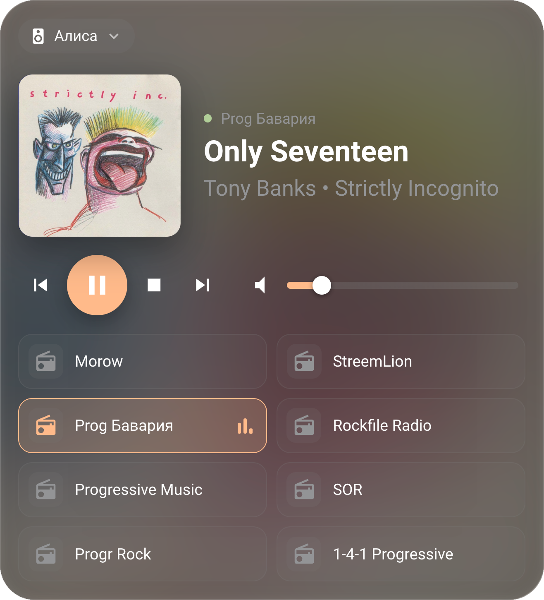
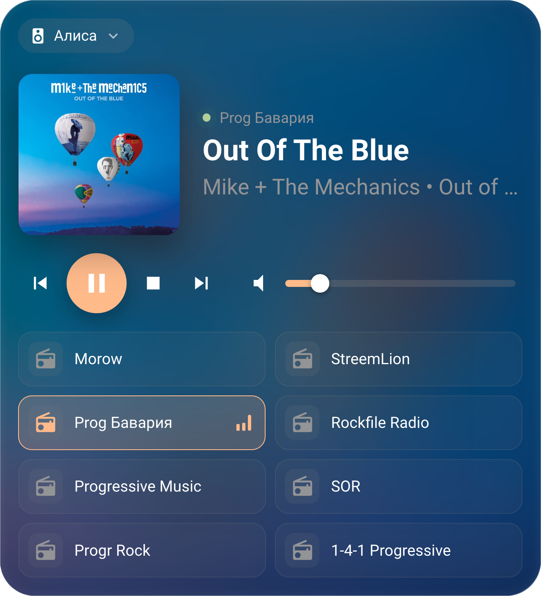

# NOEMA Radio Card

Карточка интернет-радио для Home Assistant: обложки треков, исполнитель, выбор плеера, свои станции и визуальный редактор.

<p>
  
  
</p>

## Возможности

- Название трека, исполнитель и альбом; длинные названия прокручиваются
- Обложки: от плеера → iTunes → MusicBrainz / Cover Art Archive
- Метаданные станций laut.fm через их API
- Выбор плеера прямо в карточке (избранные + все `media_player`), выбор запоминается
- Мультирум: можно отметить несколько колонок — станция, пауза, стоп, громкость и mute идут на все сразу
- Список станций с логотипами, предыдущая / следующая станция
- Громкость, mute (эмулируется, если плеер его не поддерживает), шаги громкости
- Стеклянный фон, адаптивная вёрстка
- Визуальный редактор: плееры, опции, станции (добавить, удалить, переставить)

## Установка

### HACS

1. HACS → ⋮ → **Custom repositories** → добавить `https://github.com/e2ret/noema-radio-card`, тип **Dashboard** (Lovelace).
2. Установить **NOEMA Radio Card** и перезагрузить страницу.

### Вручную

1. Скопировать `noema-radio-card.js` в `/config/www/`.
2. Настройки → Панели → Ресурсы → добавить `/local/noema-radio-card.js`, тип **JavaScript module**.

## Пример конфигурации

```yaml
type: custom:noema-radio-card
name: Радио
entities:
  - media_player.alisa
columns: 2
stations:
  - name: Prog Бавария
    url: https://stream.laut.fm/progressiv-rock
  - name: StreemLion
    url: http://eagle.streemlion.com:4040/stream
    image: https://www.streemlion.com/wp-content/uploads/2017/10/lionstreem-logo-WhiteMINITransp.png
```

## Опции

| Опция | По умолчанию | Описание |
|---|---|---|
| `name` | — | Заголовок карточки |
| `entities` | — | Избранные плееры (первый — по умолчанию) |
| `all_players` | `true` | Разрешить выбор любого `media_player` |
| `multiroom` | `true` | Выбор нескольких колонок одновременно |
| `columns` | `2` | Колонок в списке станций (1–6) |
| `glass` | `true` | Стеклянный фон |
| `cover_lookup` | `true` | Искать обложки в интернете |
| `player_art` | `true` | Использовать обложку от плеера |
| `laut_meta` | `true` | Треки laut.fm через API |
| `buttons` | все | Из `prev`, `play`, `stop`, `next`, `mute`, `volume` |
| `media_content_type` | `music` | Тип контента для `play_media` |
| `stations` | — | Список станций: `name`, `url`, `image` (необяз.), `icon` (необяз., `mdi:...`) |

## Примечания

- Мультирум работает без группировки: команды отправляются на каждую колонку отдельно, поэтому звук между ними может идти с небольшой рассинхронизацией. Название и обложка берутся с первой выбранной колонки.
- Поток воспроизводит сам плеер, а не браузер, поэтому `http://` потоки работают. Логотипы (`image`) загружаются браузером — для них нужен `https://`.
- Обложки ищутся запросами из браузера к iTunes и MusicBrainz; отключается опцией `cover_lookup: false`.

## Лицензия

MIT
